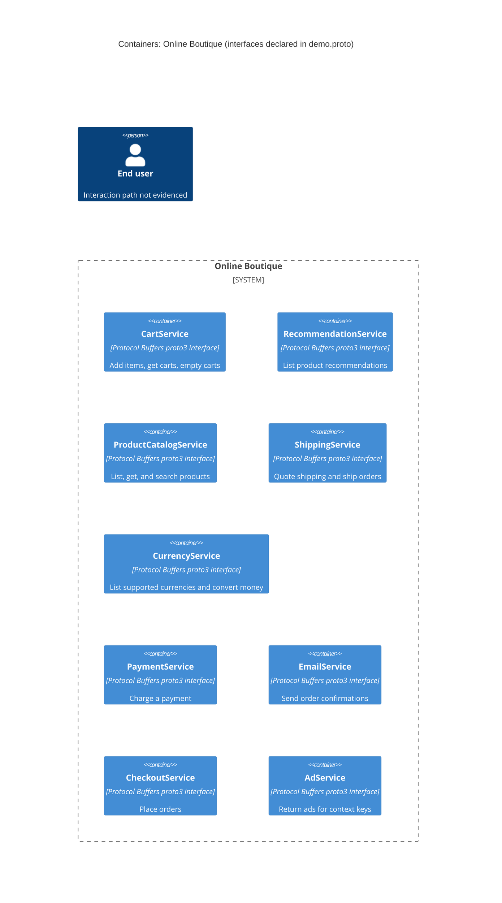

# Recovered architecture — run A

## Agent

Codex, GPT-6.

## Files read

- `prompts/1-recover-architecture.md`
- `system/online-boutique/protos/demo.proto`
- `exercise/outputs/1A-architecture.md` (verification read after creation)

## Containers table

The proto declares these service interfaces. Whether each runs as a separate container is **not evidenced in the provided files**. Technology shown is the interface format, not an implementation language.

| Name | Technology/language | Responsibility | Evidence |
|---|---|---|---|
| CartService | Protocol Buffers proto3; implementation unknown | Add items, get carts, empty carts | `system/online-boutique/protos/demo.proto` (`service CartService`; `AddItem`, `GetCart`, `EmptyCart`) |
| RecommendationService | Protocol Buffers proto3; implementation unknown | List product recommendations | `system/online-boutique/protos/demo.proto` (`service RecommendationService`; `ListRecommendations`) |
| ProductCatalogService | Protocol Buffers proto3; implementation unknown | List, get, and search products | `system/online-boutique/protos/demo.proto` (`service ProductCatalogService`; `ListProducts`, `GetProduct`, `SearchProducts`) |
| ShippingService | Protocol Buffers proto3; implementation unknown | Quote shipping and ship orders | `system/online-boutique/protos/demo.proto` (`service ShippingService`; `GetQuote`, `ShipOrder`) |
| CurrencyService | Protocol Buffers proto3; implementation unknown | List supported currencies and convert money | `system/online-boutique/protos/demo.proto` (`service CurrencyService`; `GetSupportedCurrencies`, `Convert`) |
| PaymentService | Protocol Buffers proto3; implementation unknown | Charge a payment | `system/online-boutique/protos/demo.proto` (`service PaymentService`; `Charge`) |
| EmailService | Protocol Buffers proto3; implementation unknown | Send order confirmations | `system/online-boutique/protos/demo.proto` (`service EmailService`; `SendOrderConfirmation`) |
| CheckoutService | Protocol Buffers proto3; implementation unknown | Place orders | `system/online-boutique/protos/demo.proto` (`service CheckoutService`; `PlaceOrder`) |
| AdService | Protocol Buffers proto3; implementation unknown | Return ads for context keys | `system/online-boutique/protos/demo.proto` (`service AdService`; `GetAds`) |

## Dependencies table

| Caller → callee | Protocol | Evidence |
|---|---|---|

No runtime caller → callee dependency is evidenced by `system/online-boutique/protos/demo.proto` (`rpc` declarations define callable interfaces but identify no callers or transport configuration).

## Mermaid diagram

## Gaps

- **Runtime containers and implementation languages:** Not evidenced in the provided files. Service deployment manifests and implementation source files would establish them; `go_package` alone does not establish the implementation language.
- **Caller → callee dependencies and their protocols:** Not evidenced in the provided files. Caller implementation source and runtime configuration would identify calls and transport.
- **End-user entry point, data stores, and external systems:** Not evidenced in the provided files. Frontend source and deployment manifests would establish any entry point or configured infrastructure.
