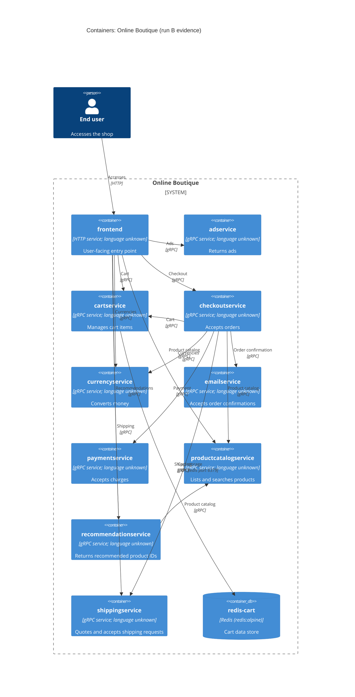

# Run B — Online Boutique container architecture

## Agent

Codex (OpenAI), GPT-6.

## Files read

- `prompts/1-recover-architecture.md`
- `system/online-boutique/protos/demo.proto`
- `system/online-boutique/kubernetes-manifests/README.md`
- `system/online-boutique/kubernetes-manifests/kustomization.yaml`
- `system/online-boutique/kubernetes-manifests/adservice.yaml`
- `system/online-boutique/kubernetes-manifests/cartservice.yaml`
- `system/online-boutique/kubernetes-manifests/checkoutservice.yaml`
- `system/online-boutique/kubernetes-manifests/currencyservice.yaml`
- `system/online-boutique/kubernetes-manifests/emailservice.yaml`
- `system/online-boutique/kubernetes-manifests/frontend.yaml`
- `system/online-boutique/kubernetes-manifests/loadgenerator.yaml`
- `system/online-boutique/kubernetes-manifests/paymentservice.yaml`
- `system/online-boutique/kubernetes-manifests/productcatalogservice.yaml`
- `system/online-boutique/kubernetes-manifests/recommendationservice.yaml`
- `system/online-boutique/kubernetes-manifests/shippingservice.yaml`

## Containers table

The application service languages are not evidenced by the provided files. `demo.proto` defines interfaces; its `go_package` option does not establish implementation languages.

| Name | Technology/language | Responsibility | Evidence |
|---|---|---|---|
| `frontend` | HTTP service; language unknown | [Inferred] User-facing entry point for the shop; exposes an HTTP LoadBalancer and is configured with service addresses. | `system/online-boutique/kubernetes-manifests/frontend.yaml` (`frontend-external`, `port: 80`, `PRODUCT_CATALOG_SERVICE_ADDR` and other `*_SERVICE_ADDR` values) |
| `adservice` | gRPC service; language unknown | Return ads for context keys. | `system/online-boutique/protos/demo.proto` (`AdService.GetAds`); `system/online-boutique/kubernetes-manifests/adservice.yaml` (`image: adservice`, Service port `grpc`) |
| `cartservice` | gRPC service; language unknown | Add items, retrieve carts, and empty carts. | `system/online-boutique/protos/demo.proto` (`CartService` RPCs); `system/online-boutique/kubernetes-manifests/cartservice.yaml` (`image: cartservice`, Service port `grpc`) |
| `checkoutservice` | gRPC service; language unknown | Accept an order placement request and return an order result. | `system/online-boutique/protos/demo.proto` (`CheckoutService.PlaceOrder`); `system/online-boutique/kubernetes-manifests/checkoutservice.yaml` (`image: checkoutservice`, Service port `grpc`) |
| `currencyservice` | gRPC service; language unknown | List supported currencies and convert money. | `system/online-boutique/protos/demo.proto` (`CurrencyService` RPCs); `system/online-boutique/kubernetes-manifests/currencyservice.yaml` (`image: currencyservice`, Service port `grpc`) |
| `emailservice` | gRPC service; language unknown | Accept order confirmation requests. | `system/online-boutique/protos/demo.proto` (`EmailService.SendOrderConfirmation`); `system/online-boutique/kubernetes-manifests/emailservice.yaml` (`image: emailservice`, Service port `grpc`) |
| `paymentservice` | gRPC service; language unknown | Accept charge requests and return transaction IDs. | `system/online-boutique/protos/demo.proto` (`PaymentService.Charge`); `system/online-boutique/kubernetes-manifests/paymentservice.yaml` (`image: paymentservice`, Service port `grpc`) |
| `productcatalogservice` | gRPC service; language unknown | List, get, and search products. | `system/online-boutique/protos/demo.proto` (`ProductCatalogService` RPCs); `system/online-boutique/kubernetes-manifests/productcatalogservice.yaml` (`image: productcatalogservice`, Service port `grpc`) |
| `recommendationservice` | gRPC service; language unknown | Return recommended product IDs. | `system/online-boutique/protos/demo.proto` (`RecommendationService.ListRecommendations`); `system/online-boutique/kubernetes-manifests/recommendationservice.yaml` (`image: recommendationservice`, Service port `grpc`) |
| `shippingservice` | gRPC service; language unknown | Quote shipping costs and accept shipping requests. | `system/online-boutique/protos/demo.proto` (`ShippingService.GetQuote`, `ShipOrder`); `system/online-boutique/kubernetes-manifests/shippingservice.yaml` (`image: shippingservice`, Service port `grpc`) |
| `redis-cart` | Redis (`redis:alpine`) | Cart data store; mounted `/data` uses an `emptyDir` volume. | `system/online-boutique/kubernetes-manifests/cartservice.yaml` (`Deployment redis-cart`, `image: redis:alpine`, `redis-data`, `emptyDir`) |

## Dependencies table

These are configured connections, inferred from caller address variables and matching Service endpoints. The provided files do not show the caller code executing each call.

| Caller → callee | Protocol | Evidence |
|---|---|---|
| End user → `frontend` | HTTP | `system/online-boutique/kubernetes-manifests/frontend.yaml` (`Service frontend-external`, `type: LoadBalancer`, port name `http`) |
| `frontend` → `productcatalogservice` | gRPC | `system/online-boutique/kubernetes-manifests/frontend.yaml` (`PRODUCT_CATALOG_SERVICE_ADDR`); `system/online-boutique/kubernetes-manifests/productcatalogservice.yaml` (Service port `grpc`) |
| `frontend` → `currencyservice` | gRPC | `system/online-boutique/kubernetes-manifests/frontend.yaml` (`CURRENCY_SERVICE_ADDR`); `system/online-boutique/kubernetes-manifests/currencyservice.yaml` (Service port `grpc`) |
| `frontend` → `cartservice` | gRPC | `system/online-boutique/kubernetes-manifests/frontend.yaml` (`CART_SERVICE_ADDR`); `system/online-boutique/kubernetes-manifests/cartservice.yaml` (Service port `grpc`) |
| `frontend` → `recommendationservice` | gRPC | `system/online-boutique/kubernetes-manifests/frontend.yaml` (`RECOMMENDATION_SERVICE_ADDR`); `system/online-boutique/kubernetes-manifests/recommendationservice.yaml` (Service port `grpc`) |
| `frontend` → `shippingservice` | gRPC | `system/online-boutique/kubernetes-manifests/frontend.yaml` (`SHIPPING_SERVICE_ADDR`); `system/online-boutique/kubernetes-manifests/shippingservice.yaml` (Service port `grpc`) |
| `frontend` → `checkoutservice` | gRPC | `system/online-boutique/kubernetes-manifests/frontend.yaml` (`CHECKOUT_SERVICE_ADDR`); `system/online-boutique/kubernetes-manifests/checkoutservice.yaml` (Service port `grpc`) |
| `frontend` → `adservice` | gRPC | `system/online-boutique/kubernetes-manifests/frontend.yaml` (`AD_SERVICE_ADDR`); `system/online-boutique/kubernetes-manifests/adservice.yaml` (Service port `grpc`) |
| `checkoutservice` → `productcatalogservice` | gRPC | `system/online-boutique/kubernetes-manifests/checkoutservice.yaml` (`PRODUCT_CATALOG_SERVICE_ADDR`); `system/online-boutique/kubernetes-manifests/productcatalogservice.yaml` (Service port `grpc`) |
| `checkoutservice` → `shippingservice` | gRPC | `system/online-boutique/kubernetes-manifests/checkoutservice.yaml` (`SHIPPING_SERVICE_ADDR`); `system/online-boutique/kubernetes-manifests/shippingservice.yaml` (Service port `grpc`) |
| `checkoutservice` → `paymentservice` | gRPC | `system/online-boutique/kubernetes-manifests/checkoutservice.yaml` (`PAYMENT_SERVICE_ADDR`); `system/online-boutique/kubernetes-manifests/paymentservice.yaml` (Service port `grpc`) |
| `checkoutservice` → `emailservice` | gRPC | `system/online-boutique/kubernetes-manifests/checkoutservice.yaml` (`EMAIL_SERVICE_ADDR`); `system/online-boutique/kubernetes-manifests/emailservice.yaml` (Service port `grpc`) |
| `checkoutservice` → `currencyservice` | gRPC | `system/online-boutique/kubernetes-manifests/checkoutservice.yaml` (`CURRENCY_SERVICE_ADDR`); `system/online-boutique/kubernetes-manifests/currencyservice.yaml` (Service port `grpc`) |
| `checkoutservice` → `cartservice` | gRPC | `system/online-boutique/kubernetes-manifests/checkoutservice.yaml` (`CART_SERVICE_ADDR`); `system/online-boutique/kubernetes-manifests/cartservice.yaml` (Service port `grpc`) |
| `recommendationservice` → `productcatalogservice` | gRPC | `system/online-boutique/kubernetes-manifests/recommendationservice.yaml` (`PRODUCT_CATALOG_SERVICE_ADDR`); `system/online-boutique/kubernetes-manifests/productcatalogservice.yaml` (Service port `grpc`) |
| `cartservice` → `redis-cart` | TCP, Redis port 6379 | `system/online-boutique/kubernetes-manifests/cartservice.yaml` (`REDIS_ADDR=redis-cart:6379`, `redis-cart` Service port `tcp-redis`) |

## Mermaid diagram

## Gaps

- The implementation languages and exact RPC call paths are **Not evidenced in the provided files**. Each service's source or build definition would settle them.
- `frontend.yaml` configures `SHOPPING_ASSISTANT_SERVICE_ADDR`, but no matching Deployment, Service, or proto definition is present in the allowed evidence; `ENABLE_ASSISTANT` is commented out. Whether it is active is **Not evidenced in the provided files**. Frontend source and the deployment configuration for `shoppingassistantservice` would settle this.
- `loadgenerator.yaml` defines a `loadgenerator` Deployment with `FRONTEND_ADDR=frontend:80`, but `kustomization.yaml` comments it out and says development uses a module in `skaffold.yaml`. Its presence in a running deployment is **Not evidenced in the provided files**. `skaffold.yaml` or the applied deployment configuration would settle this.
- Whether `emailservice` uses an external email provider, `paymentservice` uses an external payment provider, or `shippingservice` uses a carrier is **Not evidenced in the provided files**. Their implementations or deployment configuration would settle these integrations.
